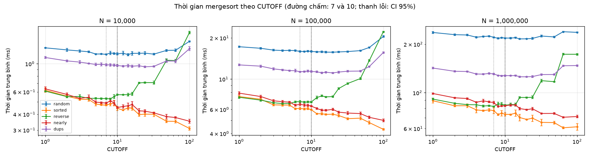

# Thực nghiệm tìm giá trị CUTOFF tối ưu cho Mergesort

Thí nghiệm đánh giá ảnh hưởng của ngưỡng `CUTOFF` (chuyển sang Insertion Sort với mảng con nhỏ) trên bản cài đặt **Top-down Mergesort từ bài giảng**, so sánh với các mốc giáo trình (`7` và `10`) 

## Tóm tắt kết quả chính

- **Môi trường đo:** Intel Core Ultra 5 225H (14 nhân), Windows 11 64-bit, OpenJDK 26 (`max_heap = 8064 MB`).
- **Khoảng CUTOFF tối ưu (dữ liệu `random`):** `16–20` (vùng đáy phẳng `12–24`), giảm **8,8% – 11,6%** thời gian chạy so với mergesort thuần (`cutoff = 1`).
- **Giá trị khuyến nghị tổng quát:** **`CUTOFF = 20`** (đạt độ chậm tương đối trung bình thấp nhất trên toàn bộ 15 kịch bản: `1.125`, và `1.001` trên `random N >= 10^5`).
- **So sánh 7 vs 10:** Không khác biệt có ý nghĩa thống kê trên `random` (`p >= 0.088`), nhưng chậm hơn vùng tối ưu `16–20` khoảng 1,2%–2,3% ở `N = 10^6`.



## Các sản phẩm nộp bài

| Hạng mục | Đường dẫn | Mô tả |
| :--- | :--- | :--- |
| **Báo cáo thí nghiệm** | [`report/report.md`](report/report.md) | Mô tả thực nghiệm, bảng thống kê, 5 biểu đồ, phân tích & kết luận chi tiết |
| **Mã nguồn & Script** | [`src/`](src/) & [`scripts/`](scripts/) | `MergeSort.java`, `MergeSortTest.java`, `DataGenerator.java`, `Benchmark.java`, `analyze.py` |
| **Bộ dữ liệu thí nghiệm** | [`data/`](data/) | 15 bộ dữ liệu nén `.txt.gz` (5 phân bố × 3 kích thước $10^4, 10^5, 10^6$, cố định seed) |
| **Kết quả & Đồ thị** | [`results/`](results/) | `benchmark_results.csv`, `summary.md`, `machine_info.txt` và 5 biểu đồ trong `results/charts/` |


## Hướng dẫn chạy lại thí nghiệm

1. **Biên dịch và kiểm thử tính đúng đắn + tính ổn định (639 checks):**
   ```bash
   javac -d out src/*.java
   java -cp out MergeSortTest

2. **Chạy Benmark đo thời gian:**
   ```bash
    java -Xmx2g -cp out Benchmark results/benchmark_results.csv
   
3. **Thống kê số liệu và vẽ đồ thị:**
   ```bash
   pip install pandas numpy matplotlib scipy tabulate
   python scripts/analyze.py
