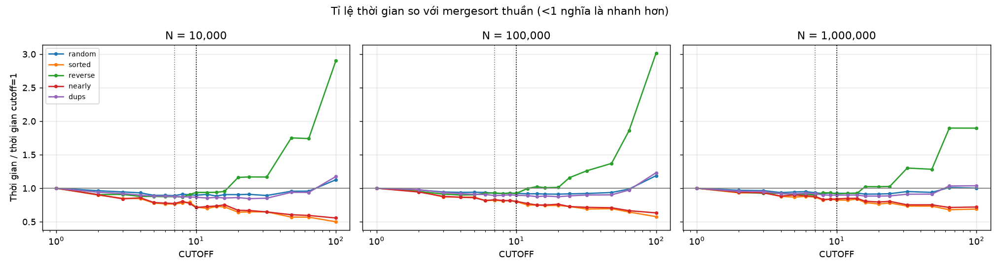
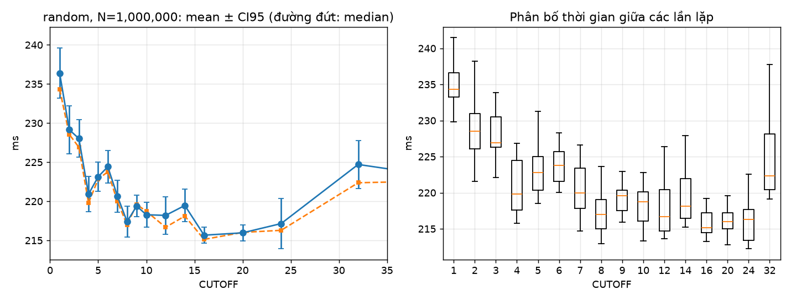

# Báo cáo thí nghiệm: tìm giá trị CUTOFF tốt nhất cho Mergesort

## 1. Mục tiêu và câu hỏi thí nghiệm

## 2. Mô tả thí nghiệm

### 2.1 Môi trường
| |                                    |
|---|------------------------------------|
| CPU | Intel(R) Core(TM) Ultra 5 225H     |
| Số nhân khả dụng | 14                                 |
| Hệ điều hành | Windows 11 10.0 amd64      |
| Java | OpenJDK 64-Bit Server VM 26 |
| Heap tối đa | 8064 MB                            |

### 2.2 Cài đặt (`src/MergeSort.java`)
- Cài đặt **từ bài giảng**: `merge(a, aux, lo, mid, hi)` , `sort(a, aux, lo, hi)` top-down
  , điều kiện cutoff `if (hi <= lo + CUTOFF - 1) { insertionSort(a, lo, hi); return; }` ,
  insertion sort dùng `less`/`exch` . Không dùng thêm cải tiến nào khác (không có "stop if already sorted",
  không "eliminate the copy") để chỉ đo ảnh hưởng của CUTOFF.
- CUTOFF là tham số thay vì hằng số. `cutoff = 1` tương đương mergesort thuần (không insertion sort) và là mốc so sánh.
- Kiểu dữ liệu: `Integer[]` qua `Comparable[]` (đúng giao diện trong bài giảng).
- Kiểm thử (`MergeSortTest`): 639 phép kiểm tra – kết quả trùng `Arrays.sort` với 9 giá trị cutoff × 5 loại dữ liệu × 14 kích thước (0…5000),
  và kiểm tra tính **ổn định** (đúng với mọi cutoff vì cả merge lẫn insertion sort đều ổn định).

### 2.3 Dữ liệu (`src/DataGenerator.java`, thư mục `data/`)
Seed cố định nên tái lập được. Năm loại dữ liệu, ba kích thước N = 10⁴, 10⁵, 10⁶:
`random` (số nguyên ngẫu nhiên), `sorted`, `reverse` (giảm dần), `nearly` (đã sắp rồi hoán đổi ngẫu nhiên N/100 cặp),
`dups` (chỉ 100 giá trị khác nhau). Dữ liệu `random` là kịch bản chính (trường hợp trung bình điển hình);
các loại còn lại để xem cutoff có "ổn định" khi đầu vào có cấu trúc.

### 2.4 Quy trình đo (`src/Benchmark.java`)
- 19 giá trị CUTOFF: 1–10, 12, 14, 16, 20, 24, 32, 48, 64, 100.
- Số lần lặp: 101 (N=10⁴), 41 (N=10⁵), 15 (N=10⁶); tổng 14 915 phép đo (`results/benchmark_results.csv`).
- **Warm-up JIT** trước khi đo (toàn cục + cục bộ cho từng bộ dữ liệu); thời gian sao chép mảng không tính.
- **Xen kẽ:** trong mỗi lần lặp, chạy lần lượt cả 19 cutoff (thứ tự xoay vòng) trên bản sao mới của cùng mảng. Nhờ vậy mọi cutoff
  chịu cùng nhiễu của máy (GC, tải nền, tần số CPU), và có thể so sánh **theo cặp** giữa các cutoff.
- Đo bằng `System.nanoTime()`, đơn vị ms.

### 2.5 Thống kê (`scripts/analyze.py`)
Với mỗi (loại dữ liệu, N, cutoff): mean, median, độ lệch chuẩn, khoảng tin cậy 95% (phân phối t). Cutoff "tốt nhất" là cutoff có
**mean nhỏ nhất**. Vì các giá trị gần đáy rất sát nhau, ta dùng **paired t-test** (cặp theo lần lặp) giữa từng cutoff và cutoff tốt nhất;
cutoff nào có p ≥ 0.05 được coi là *không khác biệt có ý nghĩa thống kê* với cutoff tốt nhất.
## 3. Kết quả

### 3.1 Cutoff tốt nhất theo từng nhóm
| dataset   |       n |   best_cutoff |   best (ms) |   cutoff=1 (ms) |   speedup_vs_pure |   cutoff=7 (ms) |   cutoff=10 (ms) |   p(7 vs 10) | cutoff không khác best (p>=0.05)   |
|:----------|--------:|--------------:|------------:|----------------:|------------------:|----------------:|-----------------:|-------------:|:-----------------------------------|
| random    |   10000 |            14 |       1.179 |           1.334 |             1.132 |           1.186 |            1.195 |        0.506 | 5 6 7 8 9 10 12 14 16 20 24 32     |
| random    |  100000 |            20 |      15.729 |          17.250 |             1.097 |          15.935 |           15.941 |        0.959 | 7 8 10 12 14 16 20 24 32           |
| random    | 1000000 |            16 |     215.663 |         236.383 |             1.096 |         220.665 |          218.278 |        0.088 | 8 12 16 20 24                      |
| sorted    |   10000 |           100 |       0.309 |           0.618 |             2.001 |           0.471 |            0.445 |        0.004 | 100                                |
| sorted    |  100000 |           100 |       4.291 |           7.447 |             1.735 |           6.106 |            5.970 |        0.066 | 100                                |
| sorted    | 1000000 |            64 |      60.614 |          89.202 |             1.472 |          77.433 |           73.562 |        0.052 | 64 100                             |
| reverse   |   10000 |             8 |       0.529 |           0.608 |             1.150 |           0.532 |            0.570 |        0.000 | 4 5 6 7 8                          |
| reverse   |  100000 |             4 |       6.617 |           7.362 |             1.113 |           6.853 |            6.797 |        0.412 | 3 4 5                              |
| reverse   | 1000000 |             7 |      82.196 |          91.314 |             1.111 |          82.196 |           83.652 |        0.022 | 4 5 7 14                           |
| nearly    |   10000 |           100 |       0.353 |           0.634 |             1.799 |           0.490 |            0.452 |        0.000 | 100                                |
| nearly    |  100000 |           100 |       4.992 |           7.895 |             1.581 |           6.543 |            6.349 |        0.006 | 100                                |
| nearly    | 1000000 |            64 |      70.469 |          98.877 |             1.403 |          86.877 |           83.119 |        0.001 | 64 100                             |
| dups      |   10000 |            24 |       0.946 |           1.120 |             1.184 |           0.981 |            0.968 |        0.359 | 10 12 14 16 20 24 32               |
| dups      |  100000 |            20 |      11.093 |          12.700 |             1.145 |          11.310 |           11.367 |        0.605 | 14 16 20 24                        |
| dups      | 1000000 |            20 |     125.569 |         142.231 |             1.133 |         130.743 |          127.718 |        0.003 | 16 20 24                           |

### 3.2 Dữ liệu random (kịch bản chính)

### N = 10,000

|   cutoff |    reps |   mean |   median |   std |   ci95 |   rel_to_c1 |
|---------:|--------:|-------:|---------:|------:|-------:|------------:|
|    1.000 | 101.000 |  1.334 |    1.317 | 0.050 |  0.010 |       1.000 |
|    2.000 | 101.000 |  1.285 |    1.234 | 0.179 |  0.035 |       0.963 |
|    3.000 | 101.000 |  1.260 |    1.220 | 0.154 |  0.030 |       0.945 |
|    4.000 | 101.000 |  1.242 |    1.209 | 0.109 |  0.022 |       0.931 |
|    5.000 | 101.000 |  1.192 |    1.175 | 0.042 |  0.008 |       0.893 |
|    6.000 | 101.000 |  1.194 |    1.176 | 0.056 |  0.011 |       0.895 |
|    7.000 | 101.000 |  1.186 |    1.173 | 0.046 |  0.009 |       0.889 |
|    8.000 | 101.000 |  1.216 |    1.167 | 0.200 |  0.039 |       0.911 |
|    9.000 | 101.000 |  1.203 |    1.174 | 0.092 |  0.018 |       0.902 |
|   10.000 | 101.000 |  1.195 |    1.162 | 0.133 |  0.026 |       0.896 |
|   12.000 | 101.000 |  1.211 |    1.158 | 0.215 |  0.042 |       0.908 |
|   14.000 | 101.000 |  1.179 |    1.153 | 0.118 |  0.023 |       0.884 |
|   16.000 | 101.000 |  1.208 |    1.163 | 0.204 |  0.040 |       0.905 |
|   20.000 | 101.000 |  1.207 |    1.164 | 0.137 |  0.027 |       0.905 |
|   24.000 | 101.000 |  1.213 |    1.161 | 0.188 |  0.037 |       0.909 |
|   32.000 | 101.000 |  1.190 |    1.160 | 0.101 |  0.020 |       0.892 |
|   48.000 | 101.000 |  1.274 |    1.236 | 0.114 |  0.023 |       0.955 |
|   64.000 | 101.000 |  1.277 |    1.245 | 0.158 |  0.031 |       0.957 |
|  100.000 | 101.000 |  1.502 |    1.478 | 0.081 |  0.016 |       1.126 |

### N = 100,000

|   cutoff |   reps |   mean |   median |   std |   ci95 |   rel_to_c1 |
|---------:|-------:|-------:|---------:|------:|-------:|------------:|
|    1.000 | 41.000 | 17.250 |   16.962 | 0.667 |  0.211 |       1.000 |
|    2.000 | 41.000 | 16.800 |   16.503 | 0.721 |  0.228 |       0.974 |
|    3.000 | 41.000 | 16.289 |   16.008 | 0.718 |  0.227 |       0.944 |
|    4.000 | 41.000 | 16.178 |   16.009 | 0.574 |  0.181 |       0.938 |
|    5.000 | 41.000 | 16.219 |   15.954 | 0.605 |  0.191 |       0.940 |
|    6.000 | 41.000 | 16.163 |   15.992 | 0.663 |  0.209 |       0.937 |
|    7.000 | 41.000 | 15.935 |   15.613 | 0.657 |  0.207 |       0.924 |
|    8.000 | 41.000 | 15.907 |   15.802 | 0.545 |  0.172 |       0.922 |
|    9.000 | 41.000 | 16.018 |   15.976 | 0.621 |  0.196 |       0.929 |
|   10.000 | 41.000 | 15.941 |   15.722 | 0.586 |  0.185 |       0.924 |
|   12.000 | 41.000 | 15.811 |   15.473 | 0.676 |  0.213 |       0.917 |
|   14.000 | 41.000 | 15.838 |   15.692 | 0.710 |  0.224 |       0.918 |
|   16.000 | 41.000 | 15.750 |   15.469 | 0.683 |  0.216 |       0.913 |
|   20.000 | 41.000 | 15.729 |   15.518 | 0.525 |  0.166 |       0.912 |
|   24.000 | 41.000 | 15.803 |   15.622 | 0.560 |  0.177 |       0.916 |
|   32.000 | 41.000 | 15.900 |   15.598 | 0.647 |  0.204 |       0.922 |
|   48.000 | 41.000 | 16.150 |   15.908 | 0.613 |  0.193 |       0.936 |
|   64.000 | 41.000 | 17.037 |   16.833 | 0.537 |  0.170 |       0.988 |
|  100.000 | 41.000 | 20.487 |   20.152 | 0.931 |  0.294 |       1.188 |

### N = 1,000,000

|   cutoff |   reps |    mean |   median |   std |   ci95 |   rel_to_c1 |
|---------:|-------:|--------:|---------:|------:|-------:|------------:|
|    1.000 | 15.000 | 236.383 |  234.337 | 5.815 |  3.220 |       1.000 |
|    2.000 | 15.000 | 229.144 |  228.556 | 5.512 |  3.052 |       0.969 |
|    3.000 | 15.000 | 228.023 |  226.903 | 4.332 |  2.399 |       0.965 |
|    4.000 | 15.000 | 220.914 |  219.797 | 4.050 |  2.243 |       0.935 |
|    5.000 | 15.000 | 223.139 |  222.824 | 3.377 |  1.870 |       0.944 |
|    6.000 | 15.000 | 224.418 |  223.778 | 3.701 |  2.050 |       0.949 |
|    7.000 | 15.000 | 220.665 |  219.985 | 3.676 |  2.036 |       0.934 |
|    8.000 | 15.000 | 217.401 |  217.003 | 3.545 |  1.963 |       0.920 |
|    9.000 | 15.000 | 219.385 |  219.589 | 2.463 |  1.364 |       0.928 |
|   10.000 | 15.000 | 218.278 |  218.722 | 2.854 |  1.581 |       0.923 |
|   12.000 | 15.000 | 218.194 |  216.675 | 4.320 |  2.392 |       0.923 |
|   14.000 | 15.000 | 219.462 |  218.106 | 3.745 |  2.074 |       0.928 |
|   16.000 | 15.000 | 215.663 |  215.124 | 1.856 |  1.028 |       0.912 |
|   20.000 | 15.000 | 215.963 |  216.019 | 1.848 |  1.023 |       0.914 |
|   24.000 | 15.000 | 217.148 |  216.285 | 5.835 |  3.231 |       0.919 |
|   32.000 | 15.000 | 224.709 |  222.370 | 5.527 |  3.061 |       0.951 |
|   48.000 | 15.000 | 221.816 |  222.802 | 4.045 |  2.240 |       0.938 |
|   64.000 | 15.000 | 239.001 |  239.413 | 3.456 |  1.914 |       1.011 |
|  100.000 | 15.000 | 236.740 |  236.472 | 2.490 |  1.379 |       1.002 |

### 3.3 Đồ thị

## Độ chậm tương đối trung bình so với cutoff tốt nhất (1.000 = tốt nhất)

|   cutoff |   mọi nhóm |   N>=1e5 |   random N>=1e5 |
|---------:|-----------:|---------:|----------------:|
|    1.000 |      1.343 |    1.289 |           1.096 |
|    2.000 |      1.263 |    1.228 |           1.065 |
|    3.000 |      1.218 |    1.186 |           1.046 |
|    4.000 |      1.196 |    1.157 |           1.026 |
|    5.000 |      1.173 |    1.156 |           1.033 |
|    6.000 |      1.162 |    1.144 |           1.034 |
|    7.000 |      1.156 |    1.138 |           1.018 |
|    8.000 |      1.152 |    1.120 |           1.010 |
|    9.000 |      1.155 |    1.126 |           1.018 |
|   10.000 |      1.134 |    1.117 |           1.013 |
|   12.000 |      1.128 |    1.111 |           1.008 |
|   14.000 |      1.134 |    1.112 |           1.012 |
|   16.000 |      1.131 |    1.103 |           1.001 |
|   20.000 |      1.125 |    1.100 |           1.001 |
|   24.000 |      1.134 |    1.114 |           1.006 |
|   32.000 |      1.149 |    1.142 |           1.026 |
|   48.000 |      1.197 |    1.153 |           1.028 |
|   64.000 |      1.281 |    1.282 |           1.096 |
|  100.000 |      1.498 |    1.447 |           1.200 |

## 4. Phân tích

1. **Cutoff có ích rõ rệt.** Trên dữ liệu random, so với mergesort thuần (cutoff=1) thời gian giảm khoảng 22% (N=10⁴, cutoff 32),
   13% (N=10⁵, cutoff 24) và 11% (N=10⁶, cutoff 24). Lý do: ở mức đệ quy thấp nhất mergesort phải gọi đệ quy, copy sang `aux` và trộn cho những mảng chỉ vài phần tử,
   trong khi insertion sort trên mảng ≤ vài chục phần tử gần như không có overhead.
2. **Đường cong có đáy phẳng và rộng (khoảng 12–32).** Chi phí của insertion sort tăng theo bình phương kích thước khối nên cutoff quá lớn
   (64, 100) làm thời gian tăng trở lại, nhưng trong vùng 12–32 chênh lệch giữa các giá trị nhỏ hơn nhiễu đo. Ở N=10⁶ hầu hết cutoff từ 2 đến 48 không khác best có ý nghĩa thống kê.
   Điều này cho thấy **không nên tin vào "một con số chính xác"**; kết luận đúng là một khoảng.
3. **7 và 10 gần như tương đương nhau** (paired t-test cho random: p = 0.59, 0.63, 0.24 với N = 10⁴, 10⁵, 10⁶; không khác biệt có ý nghĩa).
   Tuy nhiên với N=10⁵ cả hai đều chậm hơn cutoff 24 khoảng 6–7% và nằm ngoài nhóm "không khác best"; ở N=10⁶ chậm hơn 2–5% nhưng chưa đủ ý nghĩa thống kê do nhiễu lớn.
   Trên máy này giá trị lớn hơn (khoảng 16–24) cho kết quả nhỉnh hơn 7/10.
4. **Dữ liệu có cấu trúc cho đáp án khác nhau.**
   - `sorted`, `nearly`: cutoff lớn (64–100, biên của dải thử) thắng, vì insertion sort chạy tuyến tính trên dữ liệu gần có thứ tự trong khi mergesort bài giảng
     không có bước "stop if already sorted" nên luôn trộn đủ N lg N. Đây là lý do cutoff lớn trông "tốt" ở các nhóm này, không phải thông tin về dữ liệu ngẫu nhiên.
   - `reverse`: đúng trường hợp xấu nhất của insertion sort (bình phương), nên cutoff tốt nhất nhỏ (7–12) và cutoff 64–100 chậm rõ rệt
     (ví dụ N=10⁵: cutoff 100 → khoảng 19 ms so với khoảng 7.5 ms ở cutoff 7).
   - `dups`: cutoff tốt nhất 10–16.
   Vì vậy ta chọn cutoff theo `random` (trường hợp tổng quát) và dùng các nhóm còn lại để kiểm tra độ bền; giá trị khoảng 16 cho độ chậm tương đối nhỏ nhất khi gộp mọi nhóm và vẫn nằm trong nhóm "không khác best" ở cả ba N của `random`.
5. **Độ tin cậy của phép đo.** Ở N=10⁶ chỉ có 15 lần lặp và CI95 khoảng ±15–20 ms (~7% giá trị trung bình), nên khó phân biệt các cutoff gần nhau;
   khi N nhỏ hơn thì nhiễu tương đối của thời gian ngắn (≈1 ms) cũng lớn (ví dụ N=10⁴ có độ lệch chuẩn rất khác nhau giữa các cutoff).
   Thiết kế xen kẽ + paired test giúp giảm ảnh hưởng nhiễu, nhưng điểm cực tiểu chính xác (24 hay 32...) không nên diễn giải quá mức.

## 5. Kết luận

- Trên máy đo, với mergesort cài theo bài giảng và dữ liệu `random`, **CUTOFF tốt nhất theo trung bình là 24** (N=10⁵, 10⁶); vùng gần tối ưu rộng, khoảng **12–32**.
  Để chọn một giá trị cho mọi loại dữ liệu và kích thước, **CUTOFF ≈ 16** là lựa chọn an toàn (chậm hơn best khoảng 2–3% trên random với N ≥ 10⁵; ở N=10⁴ chênh ~6% nhưng nhiễu lớn; và có độ chậm tương đối nhỏ nhất khi gộp mọi nhóm).
- So với mergesort thuần, cutoff phù hợp giúp nhanh hơn khoảng 11–13% (N ≥ 10⁵) trên dữ liệu random.
- CUTOFF 7 và 10 của giáo trình không khác nhau có ý nghĩa thống kê và chậm hơn mức tối ưu của máy này một chút (~2–7% trên random); giá trị tối ưu phụ thuộc phần cứng/JVM nên cần đo lại trên từng máy.

## 6. Hạn chế
- Đo trên một máy (VM 1 vCPU), một JVM, nên nhiễu nền có thể lớn; chỉ có 15 lần lặp ở N=10⁶.
- Chỉ thử kiểu `Integer` (đối tượng đóng hộp, so sánh qua `compareTo`); kiểu khác (String, đối tượng lớn, `int[]`) có thể cho cutoff khác.
- Lưới cutoff thưa ở phía lớn (32, 48, 64, 100); có thể mịn hơn quanh 12–32 và tăng số lần lặp nếu cần phân biệt chính xác.
- Chưa so sánh với các cải tiến khác (stop-if-sorted, bỏ bước copy), vốn sẽ thay đổi kết quả trên dữ liệu có thứ tự.

## 7. Tái lập
Xem `README.md`: `bash scripts/run_all.sh` biên dịch, kiểm thử, sinh dữ liệu, đo, và vẽ đồ thị. Dữ liệu thô: `results/benchmark_results.csv`.
